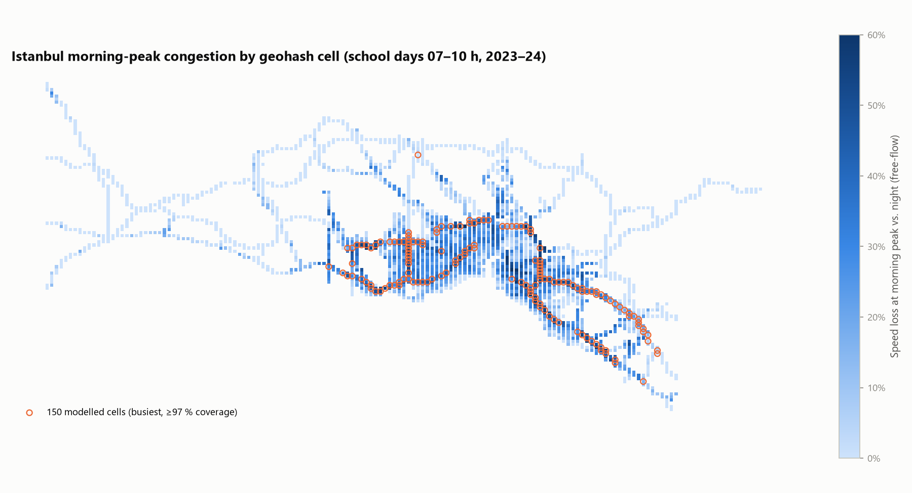
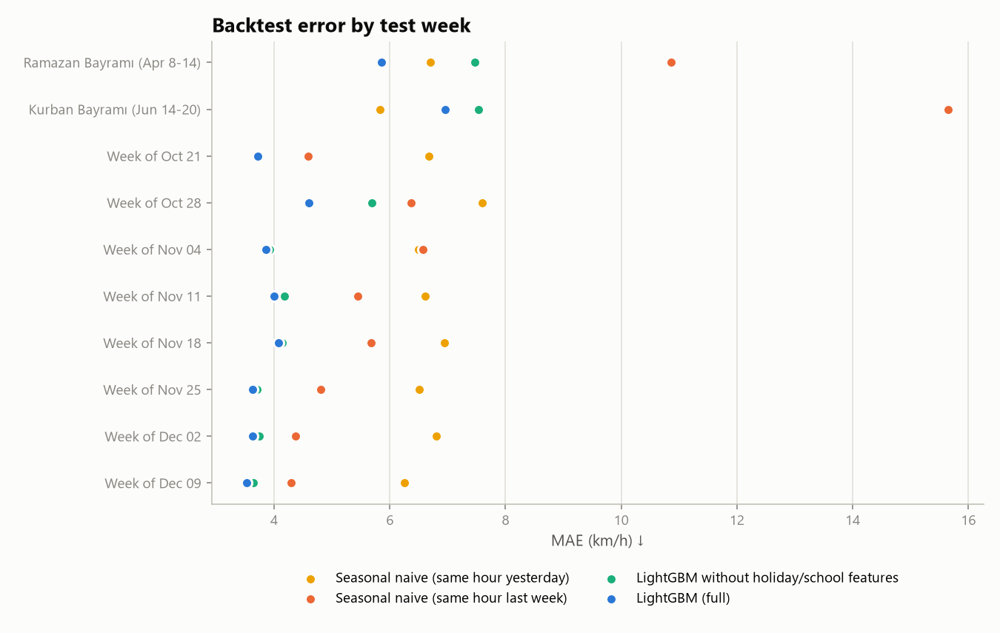
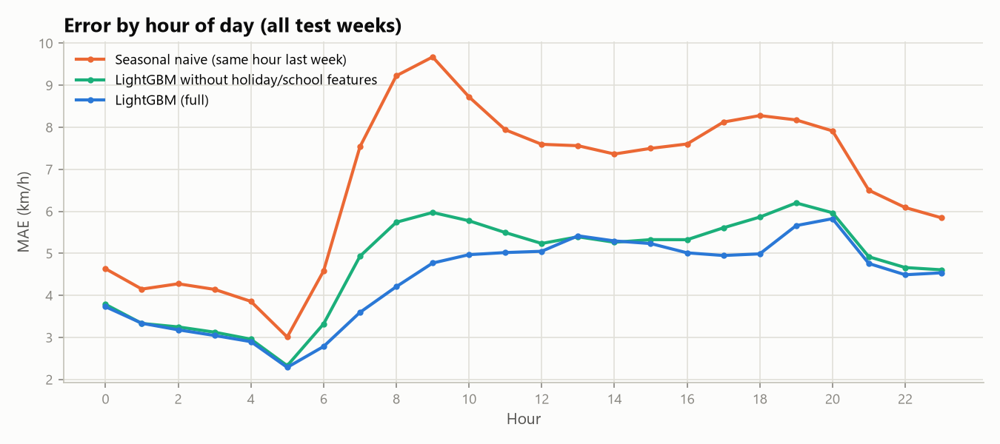
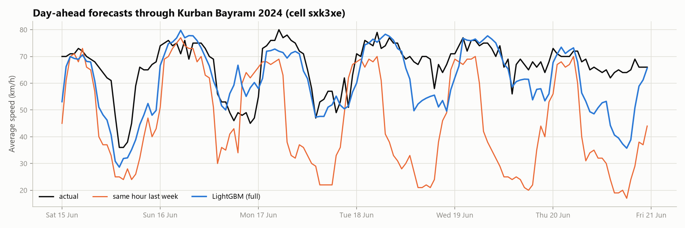
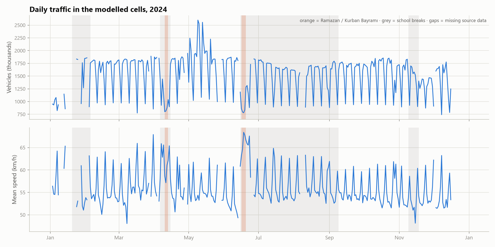
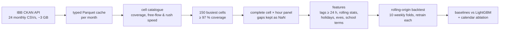

# Istanbul Traffic Forecasting — Day-Ahead Speed Forecasts from IBB Open Data

[](https://github.com/mihribansoykan/istanbul-traffic-forecasting/actions/workflows/ci.yml)


> 🇹🇷 **Türkçe özet:** İstanbul Büyükşehir Belediyesi'nin (İBB) açık verisindeki saatlik trafik yoğunluğu kayıtlarıyla (2023–2024, 24 ay, 2.464 hücre) en yoğun 150 bölgenin ertesi gün saatlik ortalama hızını tahmin eden bir model geliştirildi. Model resmî ve dini bayramları, arife günlerini ve **MEB okul takvimini** (deprem sonrası uzatılan 2023 tatili dahil) özellik olarak kullanıyor. Geriye dönük testlerde LightGBM, "geçen hafta aynı saat" yöntemine göre hatayı normal haftalarda **%26**, bayram günlerinde **%52** azaltıyor. Bayram günlerinde en güçlü basit yöntem olan "dün aynı saat"i de %7 geçiyor. Bir yıl daha geçmiş veri eklemek, modelin önceki yılın bayramlarından öğrenmesini sağlayarak Ramazan Bayramı haftasındaki hatayı 8,7'den 6,0 km/sa'e indiriyor.

---

## The question

Could a traffic control centre or a logistics planner know **tomorrow's hourly speed** on Istanbul's busiest road segments, and get it right on the days when routines break (Bayrams, school holidays)?

<p align="center"></p>

## Key results

Rolling-origin backtest over **10 test weeks** (8 consecutive weeks in Oct–Dec 2024 + the Ramazan and Kurban Bayramı weeks). The model is retrained before each week and forecasts are made day-ahead. MAE is in km/h, over 150 cells × hours.

| Model | All weeks | Ordinary weeks | Bayram weeks | Holiday days only |
|---|---|---|---|---|
| Seasonal naive: same hour yesterday | 6.67 | 6.74 | **6.33** | 7.21 |
| Seasonal naive: same hour last week | 6.62 | 5.28 | 12.93 | 14.13 |
| LightGBM without holiday/school features | 4.69 | 4.10 | 7.50 | 8.44 |
| **LightGBM (full)** | **4.31** | **3.89** | **6.33** | **6.73** |

- **−35 % error overall** and **−26 % on ordinary weeks** compared with the strongest baseline (WAPE 7.7 %).
- **Calendar features pay off where they should:** −20 % error on holiday days and −15 % on weekdays during school breaks. On ordinary days they make almost no difference.
- **History length matters for moving holidays:** with 2024 data only, the model had never seen a Bayram and its Ramazan-week MAE was 8.66. Adding 2023, which contains the previous year's Bayrams, brings it to **5.95**.
- As a day-ahead **congestion alert** (speed below 60 % of free-flow), the model reaches precision 0.88 and recall 0.83 (F1 **0.86**, vs 0.80 for the weekly naive forecast).

<p align="center">
  
  
</p>
<p align="center"></p>

## What the data shows

- Two weekday peaks, **08:00** and an even slower **17:00–19:00**. Weekends have one afternoon peak.
- **School runs are a big part of the morning peak:** weekday 08:00 speeds are **14 % higher** during school breaks.
- **Bayrams** cut traffic volume by about **35 %** and raise speeds by 10–23 %. Because they follow the lunar calendar they move about 11 days earlier each year, so a "same hour last week" forecast fails badly around them.

<p align="center"></p>

## Approach



| Step | Detail |
|---|---|
| **Data** | [`data.py`](src/istanbul_traffic/data.py) reads the resource list from the portal's CKAN API, streams each monthly CSV (with retries, because the portal drops connections), converts it to typed Parquet and deletes the CSV. Per-cell statistics are aggregated month by month, so two years never have to fit in memory at once. |
| **Cell selection** | The 150 busiest geohash-6 cells (≈ 1.2 × 0.6 km) that have data in ≥ 97 % of hours. Free-flow speed is taken as the mean night-time (01–05 h) speed. |
| **Calendar** | [`calendar.py`](src/istanbul_traffic/calendar.py): public and religious holidays and half-day eves (`holidays` package), plus the **MEB school calendar** for 2023–2025, including the semester break that was extended after the 6 February 2023 earthquakes. All of it is known in advance. |
| **Features** | Lags of 24/48/72/168/336 h, the 4-week same-hour mean, 24 h and 168 h rolling statistics, vehicle-count lags, *"was the lagged hour a holiday?"* flags, cell identity and location. **Every target-derived feature is at least 24 h old**, and a unit test perturbs the last 24 h and asserts that the features don't change. |
| **Model** | One global LightGBM across all cells, with the cell as a categorical feature. An ablation without calendar features measures their contribution. |
| **Evaluation** | MAE, RMSE, WAPE and skill vs. the weekly seasonal naive, broken down by day type and hour, plus congestion-alert precision and recall. |

## Data quality

The source has gaps, which are documented rather than hidden. **January 2024 is missing 12 days** (55 % of hours present), December 2024 has 72 %, and several 2023 months have 87–90 %. Missing hours are kept as `NaN`; they are never imputed and never used as targets. All test weeks have ≥ 95 % of their cell-hours, except the Kurban Bayramı week, where one day (14 June) is missing from the source.

## Reproduce

Requires [uv](https://docs.astral.sh/uv/).

```bash
git clone https://github.com/mihribansoykan/istanbul-traffic-forecasting.git
cd istanbul-traffic-forecasting
uv sync
uv run traffic-download          # 24 monthly files from data.ibb.gov.tr (~3 GB download, ~300 MB cached)
uv run traffic-backtest          # cell selection, features, 10-fold backtest, reports/ (~10 min on 18 threads)
uv run pytest                    # 18 tests on synthetic data, no network
# the "no prior Bayram" experiment:
uv run traffic-backtest --months 202401 202402 202403 202404 202405 202406 202407 202408 202409 202410 202411 202412
```

Notebooks: [`01_exploration`](notebooks/01_exploration.ipynb) (rhythms, school and holiday effects, data quality) · [`02_backtest_results`](notebooks/02_backtest_results.ipynb) (model comparison, ablation, alerts, drivers)

## Project structure

```
├── src/istanbul_traffic/
│   ├── data.py        # CKAN download, Parquet cache, cell catalogue, hourly panel
│   ├── calendar.py    # holidays, eves, school terms, distance-to-holiday
│   ├── features.py    # leakage-safe lag / rolling / calendar features
│   ├── backtest.py    # folds, baselines, LightGBM, scoring, congestion alerts
│   ├── plots.py       # report figures
│   └── pipeline.py    # CLI: traffic-backtest
├── notebooks/         # executed analysis notebooks
├── reports/           # metrics.json, backtest tables, cell catalogue, figures
└── tests/             # calendar, leakage guard, backtest and pipeline tests
```

## Limitations & next steps

- Only the 150 busiest well-covered cells are modelled. Quieter cells are noisier and would benefit from hierarchical pooling.
- There is no weather, event, accident or road-works data, and these drive most of the remaining peak-hour error.
- Each Bayram type appears only once in the training history. More years would help further.
- **Next:** quantile forecasts for alert thresholds, spatial features from neighbouring cells, and a weather feed.

## Data & licence

Traffic data: [İstanbul Büyükşehir Belediyesi Açık Veri Portalı, *Hourly Traffic Density Data Set*](https://data.ibb.gov.tr/en/dataset/hourly-traffic-density-data-set), İBB Open Data Licence. Holiday calendar: [`holidays`](https://github.com/vacanza/holidays) package. School calendar: Ministry of National Education announcements. Code is released under the [MIT License](LICENSE).
